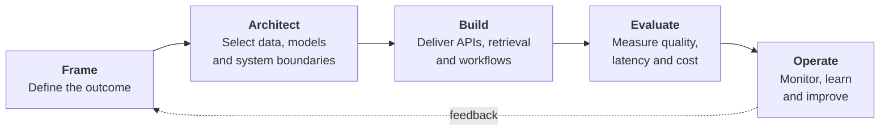

<div align="center">


**I lead engineering teams from ambiguous business problems to reliable AI products.**

[](https://linkedin.com/in/ubaidakram)
[](mailto:mrubaidakram@gmail.com)


</div>

---

## 🧭 Engineering leadership

I lead AI delivery end to end: align teams on the business outcome, shape the system architecture, guide implementation, establish evaluation, and help teams run what they ship. My experience spans enterprise search and RAG, agentic workflows, NLP, predictive modeling, and cloud deployment.

My bar for production is practical: **grounded outputs, measurable quality, controlled tool use, understood latency and cost, observable behavior, and clear human review paths.** I mentor engineers and help cross-functional teams turn uncertain requirements into dependable delivery plans.

### From business goal to production



## 📈 Outcomes delivered

<table>
<tr>
<td width="25%" align="center"><h3>~35%</h3>higher search relevance<br><sub>Enterprise search</sub></td>
<td width="25%" align="center"><h3>~40%</h3>faster time to answer<br><sub>Enterprise search</sub></td>
<td width="25%" align="center"><h3>~25%</h3>fewer duplicate leads<br><sub>Salesforce matching</sub></td>
<td width="25%" align="center"><h3>~50%</h3>less video review time<br><sub>Video summarization</sub></td>
</tr>
</table>

Also contributed to a **~15% improvement in driving-behavior prediction accuracy** and an estimated **~5% profitability lift** through predictive modeling.

<sub>Approximate, project-specific outcomes reported in my professional experience. These are not benchmarks for the local showcase projects.</sub>

## 🛠️ Areas of strength

**AI product architecture**<br>


**Retrieval & evaluation**<br>


**Applied ML**<br>


**Backend & APIs**<br>


**Cloud & operations**<br>


**Data platforms**<br>


**Technical leadership**<br>


## 🚀 Selected programs

<table>
<tr>
<td width="33%" valign="top">

### Enterprise search & RAG
Led the design and rollout of enterprise search combining lexical retrieval, semantic search, and RAG. Focused the team on relevance, grounded responses, and production evaluation.

</td>
<td width="33%" valign="top">

### Agentic workflow automation
Engineered multi-step, tool-using workflows with LangChain and LangGraph. Deployed on AWS with Docker and Kubernetes, removing manual handoffs across three downstream teams.

</td>
<td width="33%" valign="top">

### Applied machine learning
Delivered transformer-based video summarization, Salesforce lead matching, and predictive models for real-time vehicle data. Partnered across product, data, and engineering to move models into real workflows.

</td>
</tr>
</table>

## 💼 Experience

| Role | Organization | Dates |
| --- | --- | --- |
| **Lead AI Engineer / Technical Lead** | Arbisoft · Lahore, Pakistan | Jan 2023–Sep 2026 |
| **Senior AI/ML Engineer / Team Lead** | Octaloop IT & NS · Lahore, Pakistan | Jan 2022–Dec 2022 |
| **AI/ML Software Engineer** | DigiMark Developers · Lahore, Pakistan | Dec 2018–Dec 2021 |

Career timeline, drawn to scale:

```text
              2018  2020  2022  2024  2026
Arbisoft      ···············███████████·
Octaloop      ············███············
DigiMark      ···█████████···············
```

## 🎓 Education

**M.S. Data Science** — Lahore University of Management Sciences<br>
**B.S. Software Engineering** — National University of Computer and Emerging Sciences

## 📜 Certifications

- AWS Certified Machine Learning – Specialty — resume lists validity through March 2026
- NVIDIA-Certified Professional: Generative AI LLMs — resume lists validity through January 2024

---

<div align="center">

**Building practical AI. Growing strong engineering teams. Delivering measurable outcomes.**

[LinkedIn](https://linkedin.com/in/ubaidakram) &nbsp;·&nbsp; [Email](mailto:mrubaidakram@gmail.com)


</div>
