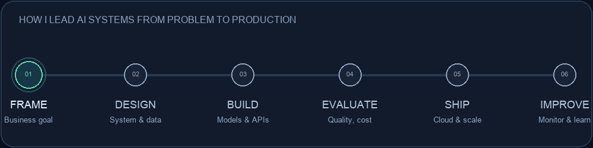

# Ubaid Akram

### Lead AI Engineer | Technical Lead | Generative AI & Machine Learning

**I lead teams that turn complex business problems into reliable AI products.**

8 years in software engineering · 6+ years building ML and generative AI systems

[LinkedIn](https://linkedin.com/in/ubaidakram) · [Email](mailto:mrubaidakram@gmail.com) · Islamabad, Pakistan

## Leadership profile

I lead AI engineering from **problem definition to production operations**: align on outcomes with stakeholders, shape system architecture, guide implementation, establish evaluation, and help teams operate what they ship. My work spans enterprise search and RAG, agentic workflows, NLP, predictive modeling, and cloud-native delivery.

I focus on production qualities that matter: **measurable relevance and model quality, grounded outputs, controlled tool access, latency and cost, observability, and clear human review paths.** I mentor engineers and set practical technical standards that help teams deliver with confidence.

## Selected outcomes

| Business problem | System delivered | Reported outcome |
| --- | --- | ---: |
| Finding answers across enterprise knowledge | Hybrid lexical + semantic enterprise search with RAG | **~35%** higher relevance; **~40%** faster time-to-answer |
| Duplicate Salesforce leads | AI-assisted lead matching and merge review | **~25%** fewer duplicate leads |
| Reviewing internal video libraries | Transformer-based video summarization | **~50%** less review time |
| Predicting driving behavior from vehicle data | LightGBM models and large-scale data processing | **~15%** higher prediction accuracy |
| Improving product decisions with limited data | Predictive modeling and feature refinement | **~5%** estimated profitability lift |

Approximate outcomes from my professional experience. They are project-specific resume-reported results, not benchmarks for the local portfolio examples.

## Technical leadership & engineering

<table>
<tr><td><b>AI architecture</b></td><td>LLM applications · RAG · Hybrid search · Agentic workflows · Tool/function calling · MCP</td></tr>
<tr><td><b>Retrieval & evaluation</b></td><td>Embeddings · Semantic search · Enterprise search · AI evaluation · Pinecone · FAISS · pgvector · Chroma</td></tr>
<tr><td><b>Machine learning</b></td><td>PyTorch · Transformers · LightGBM · NLP · Predictive analytics · PySpark</td></tr>
<tr><td><b>Platforms & APIs</b></td><td>Python · SQL · FastAPI · REST · Microservices · Salesforce</td></tr>
<tr><td><b>Cloud & operations</b></td><td>AWS · Bedrock · SageMaker · Docker · Kubernetes · CI/CD · MLflow</td></tr>
<tr><td><b>Data systems</b></td><td>Kafka · Airflow · Large-scale data processing</td></tr>
<tr><td><b>Team leadership</b></td><td>Technical direction · Mentoring · Cross-functional planning · Stakeholder communication · Delivery standards</td></tr>
</table>

## Selected programs

### Enterprise search platform
Led the design and rollout of enterprise search combining lexical retrieval, semantic methods, and RAG. Set direction across retrieval quality and production delivery, using Pinecone, FAISS, and pgvector patterns.

### Agentic workflow automation
Engineered multi-step, tool-using workflows with LangChain and LangGraph. Deployed on AWS with Docker and Kubernetes, removing manual handoffs across three downstream teams.

### Applied ML portfolio
Delivered video summarization, Salesforce lead matching, and vehicle-behavior prediction. Partnered with product, data, and engineering teams to define useful outcomes and move models into real workflows.

## Experience

**Lead AI Engineer / Technical Lead** · Arbisoft · Jan 2023–Sep 2026  
**Senior AI/ML Engineer / Team Lead** · Octaloop IT & NS · Jan 2022–Dec 2022  
**AI/ML Software Engineer** · DigiMark Developers · Dec 2018–Dec 2021

## Education

**M.S. Data Science** · Lahore University of Management Sciences  
**B.S. Software Engineering** · National University of Computer and Emerging Sciences

## Certifications

- AWS Certified Machine Learning – Specialty · Resume lists issued Mar 2025, expires Mar 2026
- NVIDIA-Certified Professional: Generative AI LLMs · Resume lists issued Jan 2023, expires Jan 2024

---

**Building practical AI systems. Growing strong engineering teams. Delivering outcomes that can be measured.**

[Connect on LinkedIn](https://linkedin.com/in/ubaidakram) · [Email Ubaid](mailto:mrubaidakram@gmail.com)

